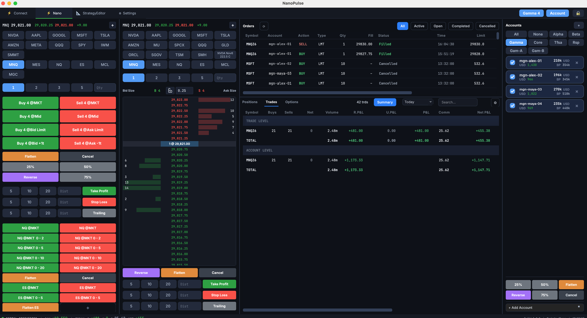
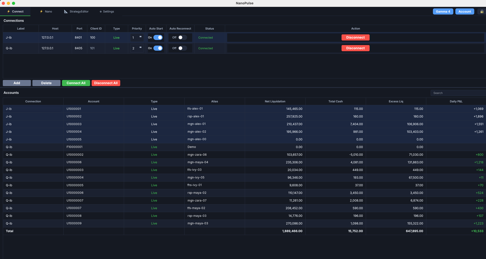
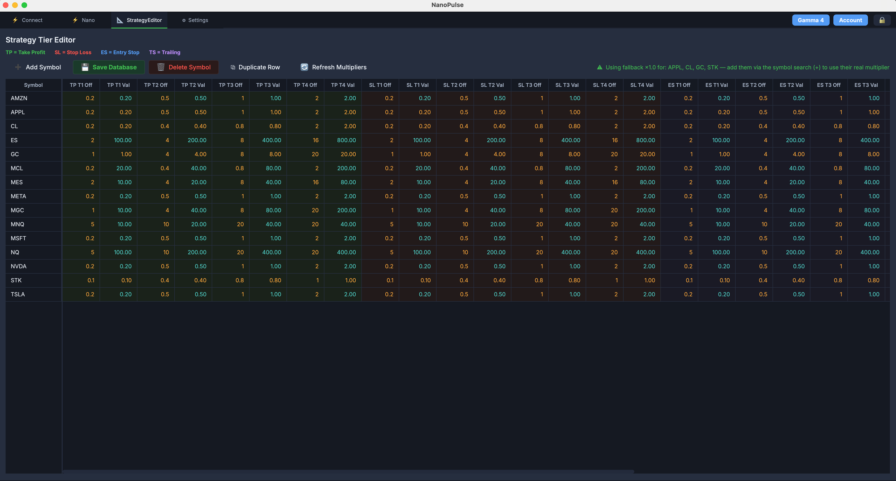
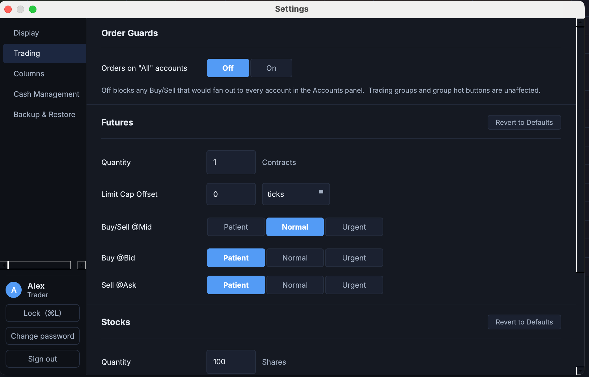

# NanoPulse

A desktop trading terminal for Interactive Brokers, built for fast, multi-account
scalping of futures, stocks and options. Python, PySide6 and
[ib_async](https://github.com/ib-api-reloaded/ib_async) against TWS or IB Gateway.



NanoPulse keeps several TWS connections open at once, shows every account they
serve side by side, and sends one click to all the accounts you have checked.
Exits are attached from per-symbol strategy tiers, so a buy can carry its take
profit, stop and trailing stop without a second thought.

> **Disclaimer.** NanoPulse is an independent project and is not affiliated with
> or endorsed by Interactive Brokers. It sends real orders to real accounts.
> Trading involves substantial risk of loss. Use at your own risk, and run it
> against a paper account first.

## Highlights

- **Multiple connections, many accounts.** One isolated worker thread per TWS or
  Gateway session, each with its own auto-reconnect. Accounts from every
  connection appear together with aliases, balances and daily P&L. A connection
  that drops hides its accounts from the position and trade views until it is
  back, so nothing on screen is stale.
- **Fan-out order entry.** Check the accounts you want, pick a symbol chip and a
  size, and every Buy/Sell button fires once per account. Account groups
  (All, None, your own named groups) switch the selection in one click. A guard
  in Settings blocks accidental orders to *every* account.
- **Book Trader ladder.** Click-to-trade depth-of-market with Level 2 (smart
  depth for SMART-routed stocks), re-centre, reverse, flatten and cancel.
- **Order types that respect the venue.** Market, limit, mid-price adaptive,
  relative pegs one tick inside the bid or ask, with urgency presets per asset
  class. Overnight stock orders are automatically converted to the limit orders
  the IBEOS venue accepts, and their exits are placed after the fill.
- **Strategy tiers.** A spreadsheet editor of take-profit, stop-loss,
  entry-stop and trailing offsets per symbol, four tiers each, stored in
  SQLite. The order panels read them as one-click Take Profit / Stop Loss /
  Trailing buttons, and brackets ride with the parent order.
- **Hot buttons.** User-defined one-click orders (side, size, type, anchor,
  offset, optional bracket) per group, shown as a grid beside the order panel.
- **Percent-of-account sizing.** Size a stock order as a percent of the
  account's deployable value instead of a share count. Each account in a
  fan-out gets its own quantity.
- **Cash-account cover.** A buy in a cash account that lacks funds first sells
  from your configured sweep holdings, then sends the buy once the sales fill.
- **Positions and Trades views.** Per-account positions with a summary mode,
  a flat trade log and a summary with FIFO realized P&L, commissions and net
  P&L, date windows down to the session, free-text search with `not x`
  exclusions, and multi-column sorting.
- **Options income ticket.** Covered calls and cash-secured puts, sized to the
  smallest capacity across the checked accounts and submitted to all of them.
- **Users and roles.** Local sign-in with hashed passwords, an admin who
  manages users but cannot trade, trader accounts that trade but cannot manage
  users, lockout after failed attempts, and a lock screen on ⌘L.
- **Backup and restore.** One `.npbak` archive carries your connections,
  layout, chips, hot buttons, groups, strategy tiers and user accounts.
  Automatic daily backups keep the last five.
- **Audit trail.** Every order action is logged with the signed-in user, next
  to a TWS wire log and the application log, all rotating.

## Screenshots

**Connect tab.** Connections with priority, auto-start and auto-reconnect, and
every account they serve.



**Strategy Tier Editor.** Offsets and values per symbol for take profit, stop
loss, entry stop and trailing.



**Settings.** Order guards, per-asset-class defaults and urgency presets,
column layout, cash management, backup and restore.



## Requirements

- Python 3.10 or newer (developed on 3.11).
- [Trader Workstation](https://www.interactivebrokers.com/en/trading/tws.php) or
  IB Gateway, with the API enabled: *Enable ActiveX and Socket Clients*, your
  machine's address in *Trusted IPs*, and the socket port noted (7496/7497 for
  TWS live/paper, 4001/4002 for Gateway by default).
- Market data subscriptions for the instruments you trade. Depth needs a Level 2
  subscription; without one the ladder renders from the top of book.

## Install and run

```bash
git clone https://github.com/amyjqian/NanoPulse.git
cd NanoPulse
python -m venv .venv && source .venv/bin/activate
pip install -r requirements.txt
python main.py
```

### First run

1. The first launch asks you to create the **admin** user. The admin manages
   users and cannot trade.
2. Open **Settings → Users** as the admin and add a **trader**. New traders get a
   temporary password and must change it at first sign-in.
3. Sign out, sign in as the trader, and open the **Connect** tab. Add a
   connection with the host, port and a unique client id for each TWS or
   Gateway session, then **Connect All**. Accounts appear as the sessions
   report them.
4. Switch to the **Nano** tab. Add symbols with the **+** chip (or `/`), check
   the accounts you want to trade, and go.

Each user keeps their own configuration, so two traders on one machine never
share chips, layouts or connections.

## How it works

- `src/core/ib_worker.py` runs one `QThread` per connection with its own
  asyncio loop: an auto-reconnect coroutine and a throttler that batches
  account, position and quote updates every 250 ms. Everything reaches the UI
  through Qt signals; the worker never touches a widget.
- `src/ui/widgets/flash_trade_view.py` composes the Nano tab from the order
  entry panel, the Book Trader ladder, the orders panel, the account list and
  the positions/trades tabs, and owns the per-account fan-out.
- Orders carry an `orderRef` of the form `nano_{date}_{time}_{tag}`; the orders
  and trades views parse the submission time back out of it and group one
  click's fills across accounts into a single band.
- Contract metadata is stored inline on each symbol chip, hot button and sweep
  symbol, captured from the live symbol search when it is added, and re-qualified
  on every connect.

### Files it writes

| Path | What |
|---|---|
| `app_config-<user>.json` | Connections, layout, chips, hot buttons, groups and preferences for that user |
| `data/users.db` | User accounts and password hashes |
| `data/strategy_tiers.db` | Strategy tiers edited in the Strategy Tier Editor |
| `data/pending_exits.json` | Overnight bracket exits waiting for their parent to fill |
| `data/logs/` | `nanopulse.log`, `nano_tws.log` and the `nano_order.log` audit trail |

All of these are ignored by git except the strategy tiers.

## Development

```bash
pytest tests/                       # full suite (pytest + pytest-qt)
pytest tests/test_trading_prefs.py  # one file
```

The suite runs headless; set `QT_QPA_PLATFORM=offscreen` if your environment
has no display. `CLAUDE.md` documents the architecture and the invariants that
are easy to break; read it before changing the worker, the order flow or the
account filtering.

```
main.py              entry point: auth flow, then the main window
src/core/            IB worker, contracts, preferences, sizing, cash cover
src/ui/              main window, pages, panels, theme and stylesheet
src/ui/widgets/      order entry, Book Trader, orders, positions, trades, options
src/auth/            users, hashing, lockout
src/backup/          .npbak export and restore
tests/               ~1000 tests
docs/screenshots/    the images on this page
```

Design notes for larger features live at the repo root:
[hot buttons](new-hot-buttons.md), [percent sizing](NanoPulse-Ladder-Percent-Sizing.md),
[options income](NanoPulse-Options-Income.md) and the [trades view](trades_view.md).
